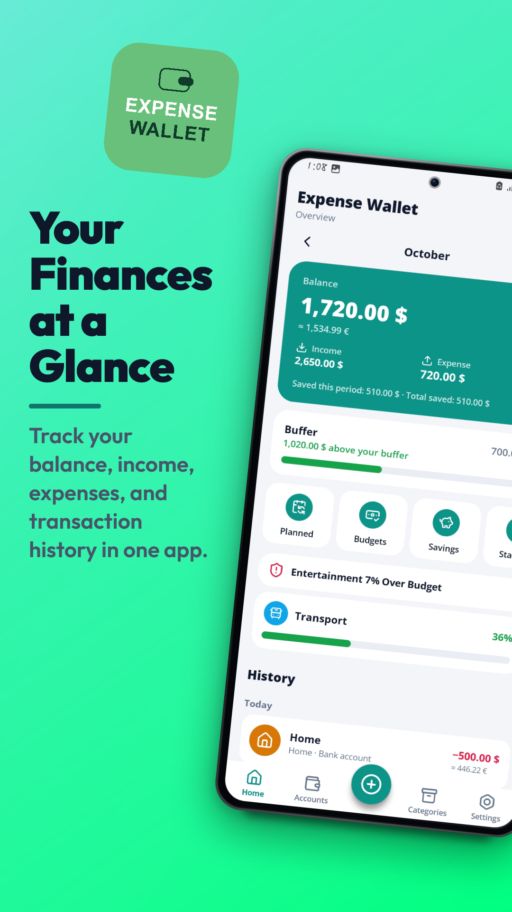
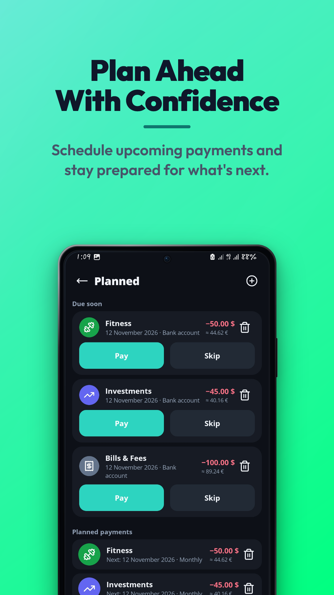
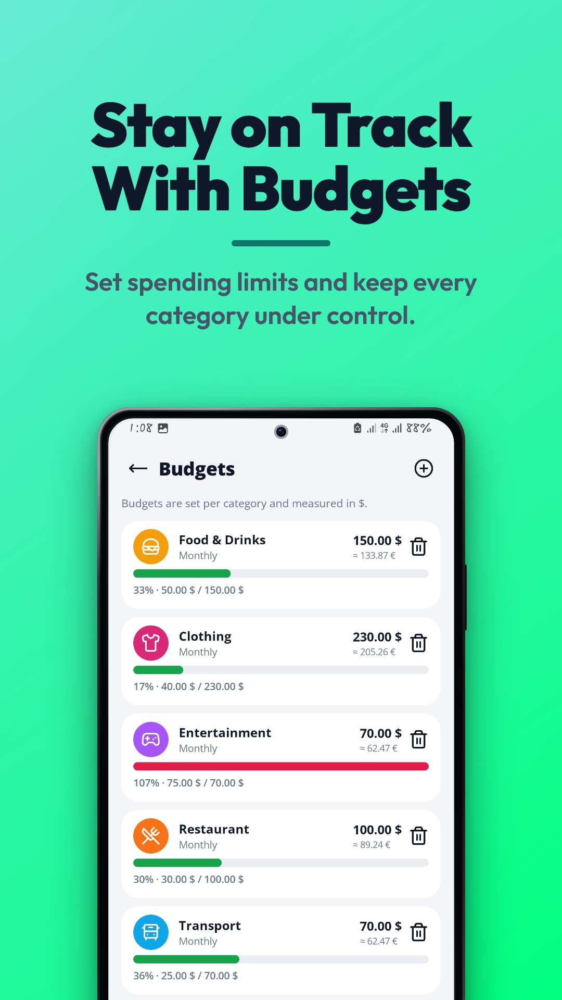
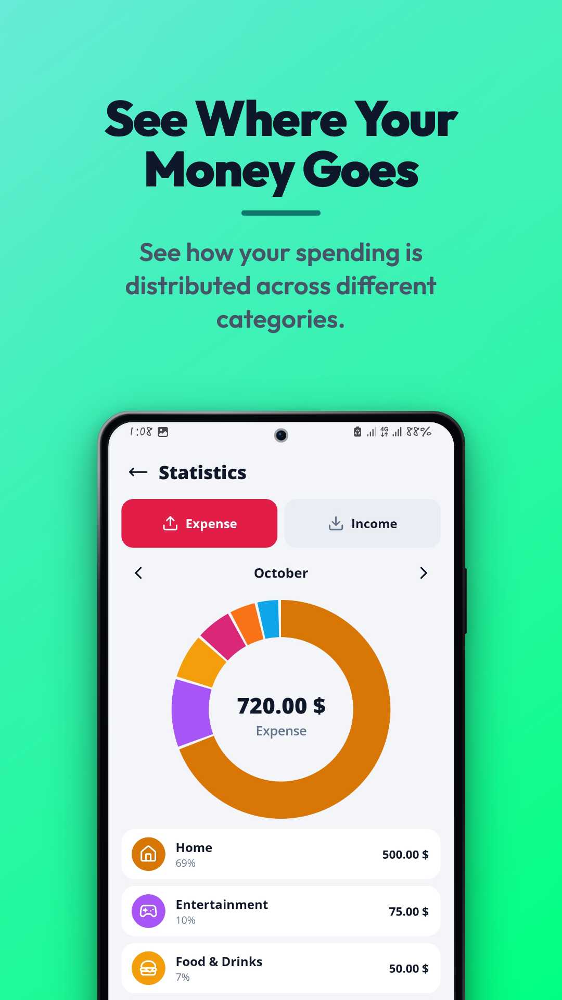
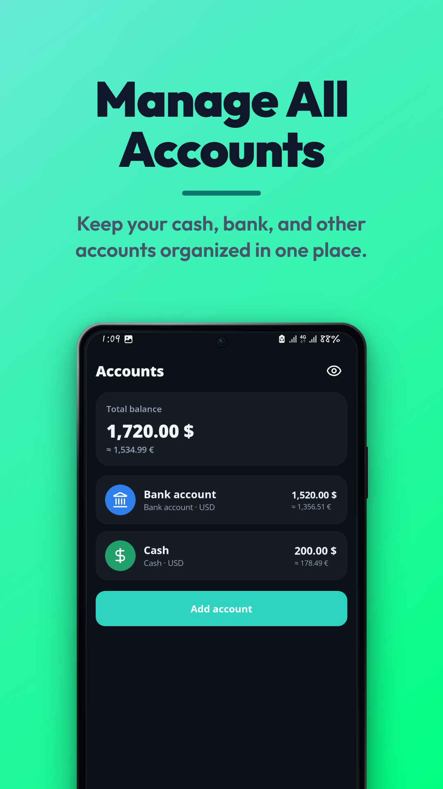
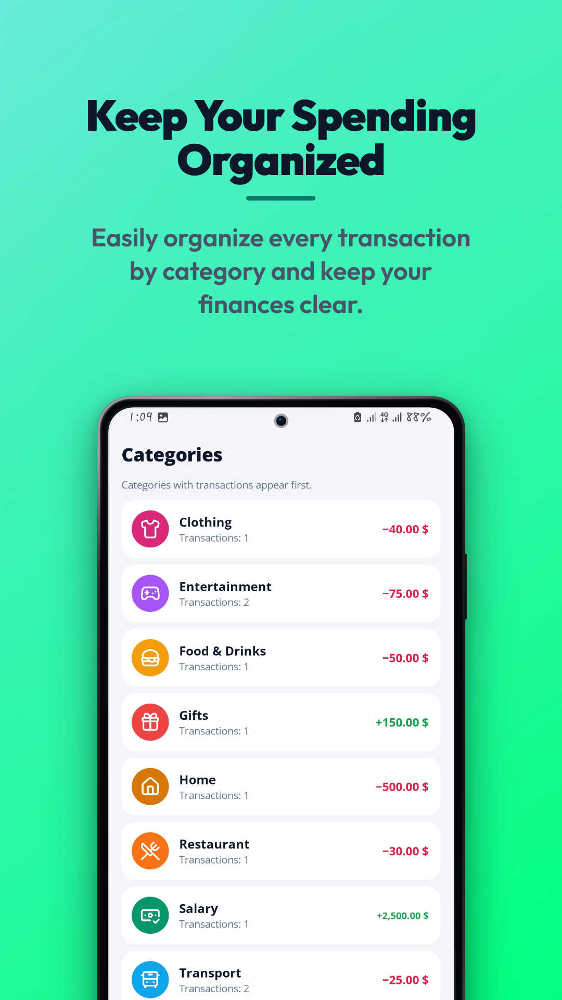
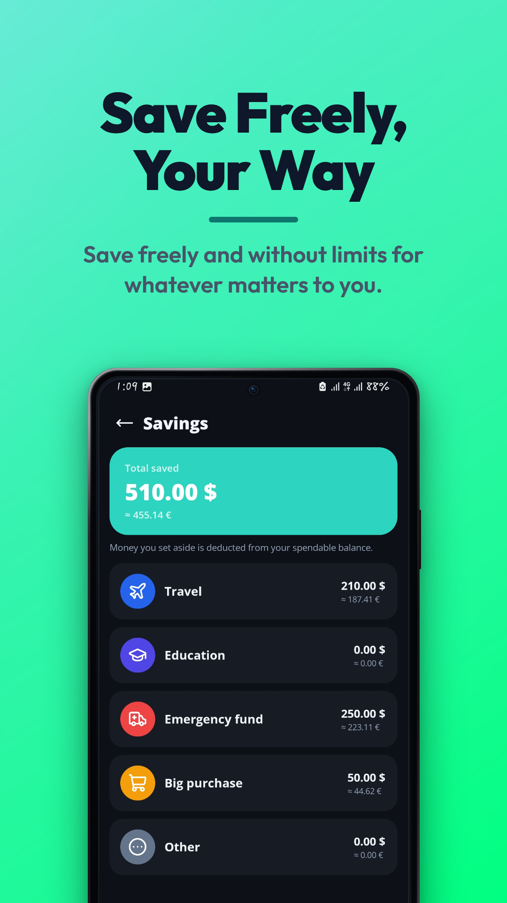
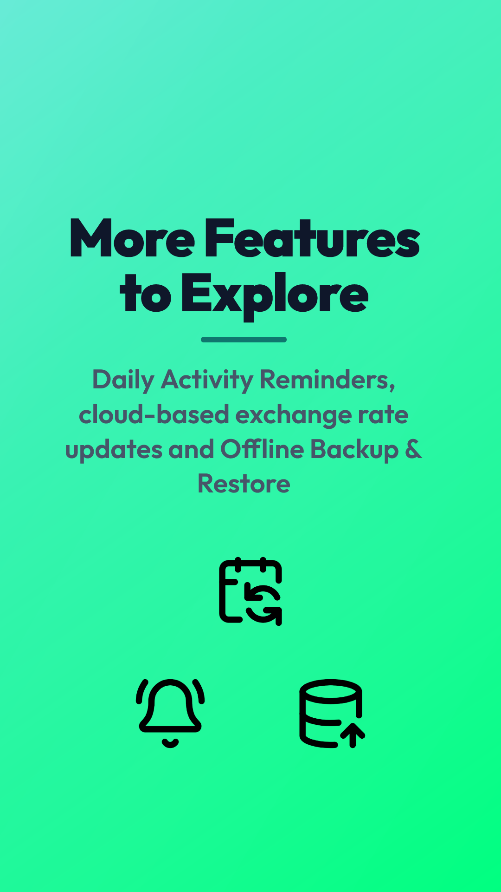

# Expense Wallet

Expense Wallet is a personal finance management Android application designed to help users manage accounts, transactions, budgets, savings, planned payments, and financial statistics in one place.

The application is designed with an offline-first approach. Personal financial data is stored locally on the device, with no user accounts, analytics, or advertisements.

The app supports **English, German, and Persian**, including Persian right-to-left (RTL) support and an optional Jalali calendar.

---

## Download

An installable APK is available on the [Releases](https://github.com/MahdiKoushkiOfficial/Expense-Wallet/releases/latest) page, so no build is required. It runs on Android 7.0 (API 24) or higher.

> Android may ask you to allow installing apps from this source the first time.

### Try it with demo data

To see the app with realistic data instead of an empty start, import the demo backup:

1. [Download the demo backup](https://github.com/MahdiKoushkiOfficial/Expense-Wallet/releases/latest/download/expense-wallet-demo-backup.json) to your phone.
2. Open Expense Wallet and tap **Restore from backup** on the welcome screen, or go to **Settings → Data → Restore from backup**.
3. Select the file and confirm.

The demo contains two months of sample data (November and December 2026): three accounts, 48 transactions, planned payments, budgets, and savings goals.

> **Note:** Restoring a backup replaces all existing data and skips the guided first-run experience described below, because the demo already contains transactions, budgets, and savings.

---

## Screenshots

<table>
  <tr>
    <td></td>
    <td></td>
    <td></td>
    <td></td>
  </tr>
  <tr>
    <td></td>
    <td></td>
    <td></td>
    <td></td>
  </tr>
</table>

---

## Features

### Accounts
- Create and manage multiple accounts
- Support for bank accounts, credit cards, and cash
- Initial balance for each account
- Rename, delete, and reorder accounts
- Automatic total balance calculation
- Deleting an account also deletes its associated transactions

### Transactions
- Record income and expenses
- Select account and category
- Add title, description, and tags
- Record date and time
- Support for settled and unsettled transactions
- Due dates for unpaid transactions
- Upcoming unpaid transactions
- Edit and delete transactions
- Search by title, tag, or category
- Budget-overrun warning before saving an expense

### Categories
- Built-in expense and income categories
- 26 predefined categories
- Category icons and colors
- Category statistics
- Total spent and received per category
- Transaction count
- Budget status

### Planned Payments
- Create recurring or planned payments
- Supported schedules:
  - Once
  - Daily
  - Weekly
  - Monthly
  - Yearly
  - Custom intervals
- Custom intervals based on days, weeks, months, or years
- Track overdue and upcoming payments
- Pay, skip, edit, or delete planned payments

### Budgets
- Create budgets for individual categories
- Daily, weekly, and monthly budgets
- Budget warnings
- Over-budget category detection
- Budget information displayed on the Home page

### Savings
- Create savings goals
- Supported goal types:
  - Travel
  - Education
  - Emergency Fund
  - Big Purchase
  - Other
- Track saved amounts
- Savings are deducted from the available spending balance
- Deleting a saving entry returns the amount to the available balance

### Buffer
- Set an optional financial safety buffer
- Keep a predefined amount protected from normal spending
- Display whether the current balance is above or below the buffer

### Statistics & Forecast
- Visualize spending by category
- Pie chart for spending statistics
- Select different time periods
- Forecast planned income and expenses
- Calculate expected future balance

### Home Dashboard
- View financial information for:
  - Fiscal month
  - Last 30 days
  - Last 7 days
  - All time
- Configurable month start day from 1 to 28
- Budget status overview
- Upcoming planned payments
- Privacy mode for hiding financial amounts

### Multi-Currency Support
- Supported currencies:
  - USD
  - EUR
  - CHF
  - IRR
- Select a base currency
- Convert account balances and transactions
- Convert budgets using exchange rates
- Update exchange rates manually
- Optional secondary exchange currency
- Exchange rates are retrieved from an external exchange-rate API

### Localization
- English
- German
- Persian
- Persian RTL interface
- Jalali calendar support
- Persian font support

### Notifications & Reminders
- Daily financial reminder
- Select reminder time
- Test reminder functionality
- Scheduled notifications using Android's alarm system

### Data Management
- Export all application data as JSON
- Restore data from a JSON backup
- Restore replaces the existing application data
- Delete all application data

### Settings
- Language selection
- Calendar selection
- Automatic, light, and dark themes
- Base currency
- Month start day
- Daily reminder settings

---

## First-Run Experience

Expense Wallet guides new users through setup, then points them to the next useful step.

### Setup in three steps

1. **Welcome:** choose the language (English, German, or Persian) and optionally enter a name. Existing users can restore a backup here.
2. **Base currency:** pick USD, EUR, CHF, or IRR and the calendar (Gregorian or Jalali).
3. **Accounts:** choose which of credit card, bank account, and cash you use, then name them and set their initial balances.

### Guided next steps on the Home screen

Short hint cards appear on the Home screen depending on what the user has already done:

| Situation | Hint |
|---|---|
| No transactions yet | Add your first transaction |
| At least one transaction, no planned payments | Plan your recurring bills |
| 3+ transactions, no budgets | Set a budget |
| 3+ transactions, no savings | Start saving towards a goal |
| 7+ transactions | Explore the Statistics |

At most two hints are shown at a time. Tapping a hint opens the matching screen, and any hint can be dismissed.

---

## Technologies

- **Java**
- **Android SDK**
- **Gradle Kotlin DSL**
- **Version Catalog**
- **Native Android Views**
- **SharedPreferences**
- **JSON**
- **AlarmManager**
- **BroadcastReceiver**
- **Custom UI components** (Material 3–inspired switch, pie chart)
- **Open Sans**
- **Vazirmatn**
- **Material Symbols**

---

## Technical Details

- **Language:** Java
- **Java Source/Target:** 11
- **Minimum SDK:** 24
- **Target SDK:** 37
- **Compile SDK:** 37
- **Architecture:** Single Activity
- **UI:** Programmatic native Android Views
- **Layouts:** No XML layouts
- **Local Storage:** SharedPreferences with JSON-based application data
- **Backup Format:** JSON
- **Notifications:** AlarmManager + BroadcastReceiver
- **Exchange Rates:** `open.er-api.com`

The application does not require an online account. Financial data remains stored locally on the device.

The only network request is used to retrieve current exchange rates. No personal financial data is sent to the exchange-rate service.

---

## Project Structure

```text
Expense-Wallet/
│
├── app/
│   ├── build.gradle.kts
│   │
│   └── src/main/
│       ├── AndroidManifest.xml
│       │
│       ├── assets/
│       │   └── fonts/
│       │       ├── OpenSans-Bold.ttf
│       │       ├── OpenSans-ExtraBold.ttf
│       │       ├── OpenSans-Regular.ttf
│       │       ├── OpenSans-SemiBold.ttf
│       │       ├── Vazirmatn-Bold.ttf
│       │       ├── Vazirmatn-Medium.ttf
│       │       └── Vazirmatn-Regular.ttf
│       │
│       ├── java/com/mahdi/expensewallet/
│       │   ├── MainActivity.java
│       │   │
│       │   ├── model/
│       │   │   ├── Account.java
│       │   │   ├── Transaction.java
│       │   │   ├── PlannedPayment.java
│       │   │   ├── Saving.java
│       │   │   ├── AppDatabase.java
│       │   │   ├── DuePayment.java
│       │   │   ├── BudgetSummary.java
│       │   │   ├── HomeBudgetSummary.java
│       │   │   └── DateRange.java
│       │   │
│       │   ├── data/
│       │   │   ├── SettingsManager.java
│       │   │   ├── DatabaseStorage.java
│       │   │   ├── ExchangeRateManager.java
│       │   │   ├── FinanceManager.java
│       │   │   └── BackupManager.java
│       │   │
│       │   ├── utils/
│       │   │   ├── CalendarUtils.java
│       │   │   ├── CurrencyUtils.java
│       │   │   ├── FormatUtils.java
│       │   │   ├── Translator.java
│       │   │   ├── Constants.java
│       │   │   ├── IdUtils.java
│       │   │   └── ValidationUtils.java
│       │   │
│       │   ├── notification/
│       │   │   ├── NotificationUtils.java
│       │   │   └── ReminderReceiver.java
│       │   │
│       │   └── ui/
│       │       ├── Navigator.java
│       │       ├── Theme.java
│       │       ├── UiHelper.java
│       │       ├── Dialogs.java
│       │       ├── SharedWidgets.java
│       │       ├── SettingsActions.java
│       │       ├── Callbacks.java
│       │       │
│       │       ├── components/
│       │       │   ├── M3Switch.java
│       │       │   └── PieView.java
│       │       │
│       │       └── pages/
│       │           ├── Page.java
│       │           ├── TabPage.java
│       │           ├── HomePage.java
│       │           ├── AccountsPage.java
│       │           ├── AccountFormPage.java
│       │           ├── AccountPage.java
│       │           ├── TransactionPage.java
│       │           ├── CategoriesPage.java
│       │           ├── CategoryPage.java
│       │           ├── CategoryPickPage.java
│       │           ├── SearchPage.java
│       │           ├── PlannedPage.java
│       │           ├── PlannedFormPage.java
│       │           ├── BudgetsPage.java
│       │           ├── BudgetFormPage.java
│       │           ├── SavingsPage.java
│       │           ├── SavingFormPage.java
│       │           ├── GoalPage.java
│       │           ├── ForecastPage.java
│       │           ├── StatsPage.java
│       │           ├── SettingsPage.java
│       │           ├── InfoPage.java
│       │           ├── DeveloperPage.java
│       │           └── OnboardPage.java
│       │
│       └── res/
│           ├── drawable/
│           ├── drawable-nodpi/
│           ├── mipmap-*/
│           ├── raw/
│           ├── values/
│           ├── values-de/
│           ├── values-fa/
│           └── xml/
│
├── demo/
│   └── expense-wallet-demo-backup.json
│
├── docs/
│   └── screenshots/
│       ├── accounts-dark.png
│       ├── budgets-light.png
│       ├── categories-light.png
│       ├── home-light.png
│       ├── more-features.png
│       ├── planned-dark.png
│       ├── savings-dark.png
│       └── statistics-light.png
│
├── gradle/
│   ├── libs.versions.toml
│   └── wrapper/
│
├── build.gradle.kts
├── gradle.properties
├── gradlew
├── gradlew.bat
├── settings.gradle.kts
├── .gitignore
└── README.md
```

---

## Installation

### Clone the Repository

```bash
git clone https://github.com/MahdiKoushkiOfficial/Expense-Wallet.git
cd Expense-Wallet
```

### Using Android Studio

1. Open the project in Android Studio.
2. Allow Gradle to sync the project.
3. Connect an Android device or start an emulator.
4. Build and run the application.

### Using Gradle

On Windows:

```bash
gradlew.bat assembleDebug
```

On Linux/macOS:

```bash
./gradlew assembleDebug
```

The generated debug APK will be available under:

```text
app/build/outputs/apk/debug/
```

---

## Privacy

Expense Wallet is designed to keep personal financial information local to the device.

- No user account is required.
- No analytics are collected.
- No advertisements are included.
- Financial data is stored locally.
- No personal financial data is sent to external services.
- Internet access is only used to retrieve exchange-rate information.
- Users can export and restore their data using JSON backups.

---

## Credits & Licenses

### Fonts

- **Open Sans** — licensed under the SIL Open Font License 1.1
- **Vazirmatn** — licensed under the SIL Open Font License 1.1

### Icons

- **Material Symbols** — licensed under the Apache License 2.0

### Exchange Rates

Exchange-rate data is retrieved from:

`open.er-api.com`

---

## Future Improvements

- Automated testing
- Additional financial analysis tools
- Further improvements to financial forecasting
- Additional customization options

---

## License

Contributions are welcome by prior agreement only. See [LICENSE](LICENSE).